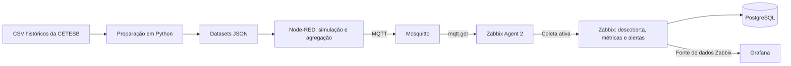

# Plataforma de Monitoramento da Qualidade do Ar Baseada em IoT

Este repositório reúne a infraestrutura computacional, os dados e os artefatos dos experimentos da pesquisa de mestrado **Plataforma de Monitoramento da Qualidade do Ar Baseada em IoT**, desenvolvida no Programa de Pós-Graduação em Tecnologia da Informação da Universidade Federal do Rio Grande do Norte (UFRN).

A proposta da pesquisa contempla dispositivos de baixo custo com sensores ambientais conectados por Wi-Fi a um servidor na nuvem. Os artefatos disponíveis implementam um laboratório de simulação: o **Node-RED** reproduz séries históricas de sensores, o **Mosquitto** transporta a telemetria por MQTT (Message Queuing Telemetry Transport), o **Zabbix** coleta e processa os dados e o **Grafana** apresenta os painéis. O provisionamento local utiliza máquinas virtuais (VMs) Ubuntu com Multipass e cloud-init.

O material destina-se a pesquisadores, desenvolvedores e mantenedores que desejam reproduzir ou estudar esses experimentos. A configuração integrada exige ajustes de ambiente e importações manuais.

## Sumário

- [Objetivos e recursos](#objetivos-e-recursos)
- [Arquitetura e dados](#arquitetura-e-dados)
- [Organização do repositório](#organização-do-repositório)
- [Tecnologias e requisitos](#tecnologias-e-requisitos)
- [Preparação do laboratório](#preparação-do-laboratório)
- [Primeira simulação](#primeira-simulação)
- [Integração com Zabbix e Grafana](#integração-com-zabbix-e-grafana)
- [Preparação dos datasets](#preparação-dos-datasets)
- [Verificação e operação](#verificação-e-operação)
- [Documentação complementar](#documentação-complementar)
- [Contexto acadêmico](#contexto-acadêmico)
- [Licença e atribuições](#licença-e-atribuições)

## Objetivos e recursos

- Simular dispositivos de Internet das Coisas (IoT) com sensores virtuais de qualidade do ar.
- Disponibilizar infraestrutura e artefatos para a reprodução dos experimentos.
- Avaliar o uso do Zabbix no monitoramento de dados ambientais no contexto de cidades inteligentes.
- Explorar descoberta de dispositivos, processamento de métricas, limiares e alertas.
- Visualizar estações em mapa, detalhes por localidade e situação dos dispositivos no Grafana.

Há exportações de **12 dispositivos simulados**, que reutilizam **seis conjuntos de dados**. Cada dispositivo agrega nove sensores: PM2.5, PM10, O₃, CO, NO₂, SO₂, temperatura, umidade e pressão. O transporte implementado nos fluxos é MQTT. O repositório também contém registros visuais de notificações por Telegram, cuja configuração de mídia e ações precisa ser realizada no Zabbix.

## Arquitetura e dados



O fluxo central é definido pelos [fluxos Node-RED](node-red/Flows/) e pelo [template Zabbix](zabbix/templates/template-mqtt-devices-iot.yaml):

1. Os nós de arquivo leem os JSONs locais, separam os registros e limitam a emissão de cada sensor a uma mensagem a cada 60 segundos.
2. A função de agregação reúne os nove sensores pelo `timestamp`. Quando todos estão presentes, publica metadados da estação, coordenadas e leituras em `airq/devices/device01/telemetria`, por exemplo, com qualidade de serviço MQTT (QoS) 1 e `retain=false`.
3. O Zabbix Agent 2 no gateway consulta o broker com `mqtt.get` e envia os dados por coleta ativa ao servidor Zabbix.
4. O template normaliza os dados, descobre dispositivos e cria itens dependentes, cálculos do Índice de Qualidade do Ar (IQAr) e triggers de qualidade do ar ou ausência de dados.
5. Os dashboards consultam o Zabbix por meio do plugin correspondente no Grafana.

Os dados históricos são provenientes da CETESB (Companhia Ambiental do Estado de São Paulo), referentes a 2024. Cada conjunto pode combinar sensores de diferentes estações físicas. Os dispositivos 01 a 06 usam `device_01` a `device_06`; os dispositivos 07 a 12 reutilizam esses mesmos diretórios, respectivamente. Os nomes e coordenadas das estações exibidas são metadados da simulação, não a localização de origem de todas as medições.

Os JSONs contêm `sensor`, `valor`, `unidade` e `timestamp`, com lacunas representadas por `null`. O agregador espera a presença dos nove sensores de um mesmo horário; a falta de um registro impede a emissão daquele pacote, enquanto um registro com valor `null` pode integrar o pacote.

A amostragem histórica é horária, mas sua reprodução ocorre na cadência do fluxo. Conforme a premissa descrita em [infos.md](infos.md), o experimento usa o horário de recepção no Zabbix para indexar as medições. O timestamp histórico permanece no payload; não se deve interpretar a linha do tempo dos painéis como uma reconstrução automática do calendário original.

Os cálculos e limiares de IQAr são os definidos no template experimental. Os nomes dos itens e os scripts avulsos não substituem a leitura das expressões efetivamente configuradas, nem demonstram validação normativa dos índices.

## Organização do repositório

| Caminho | Conteúdo |
| --- | --- |
| [cetesb_data/datalake/](cetesb_data/datalake/) | CSVs históricos organizados em seis grupos de estações. |
| [cetesb_data/dataset/](cetesb_data/dataset/) | JSONs preparados para os seis conjuntos usados na simulação. |
| [scripting/](scripting/) | Conversão dos CSVs, preenchimento temporal e scripts legados. |
| [node-red/Flows/](node-red/Flows/) | Um fluxo por dispositivo e uma exportação com as 12 abas. |
| [node-red/javascript/](node-red/javascript/) | Funções de agregação e metadados incorporadas aos fluxos exportados. |
| [mqtt-gateway/](mqtt-gateway/) | Configurações do Mosquitto, regras de acesso e Zabbix Agent 2. |
| [zabbix/](zabbix/) | Template, exportações de hosts, pré-processamento e capturas de configuração. |
| [grafana/](grafana/) | Dashboards exportados e capturas de configuração. |
| [provisioning/scripts/](provisioning/scripts/) | Instalação do Multipass, rede e criação das VMs. |
| [provisioning/cloud-init/](provisioning/cloud-init/) | Instalação e configuração inicial dos serviços nas VMs. |
| [Resultados/](Resultados/) | Capturas dos experimentos, painéis e notificações. |

## Tecnologias e requisitos

O código próprio concentra-se em JavaScript, nas funções do Node-RED e no pré-processamento Zabbix, com Python para preparar dados e Bash para provisionar o laboratório. JSON e YAML armazenam fluxos, dashboards, templates e configurações.

| Componente | Versão ou requisito observado | Fonte |
| --- | --- | --- |
| Host de provisionamento | Linux com Bash, Snap/APT, NetworkManager (`nmcli`), ferramentas `ip`, privilégios administrativos e suporte à virtualização do Multipass. | [Scripts de provisionamento](provisioning/scripts/) |
| VMs | Ubuntu `jammy` (22.04). | Scripts `create-*` em [provisioning/scripts/](provisioning/scripts/) |
| Node-RED | Instalado por Snap, sem versão fixada pelo projeto. | [node-red.yaml](provisioning/cloud-init/node-red.yaml) |
| Mosquitto | Broker e clientes instalados por APT, sem versão fixada. | [mqtt-gateway.yaml](provisioning/cloud-init/mqtt-gateway.yaml) |
| Zabbix | Repositório de pacotes da série 7.4; template exportado no formato 7.4. | [zabbix.yaml](provisioning/cloud-init/zabbix.yaml) e [template](zabbix/templates/template-mqtt-devices-iot.yaml) |
| Persistência e frontend | PostgreSQL, Apache e PHP por pacotes do sistema, sem versões completas fixadas. | [zabbix.yaml](provisioning/cloud-init/zabbix.yaml) |
| Grafana | Pacote Grafana Enterprise 12.1.0 para `amd64`; plugin `alexanderzobnin-zabbix-app` instalado sem versão fixada. | [zabbix.yaml](provisioning/cloud-init/zabbix.yaml) |
| Preparação de dados, opcional | Python 3 com `pandas` e `numpy`; sem manifesto ou lockfile de versões. | [Conversor Python](scripting/transform_datalake_csv_to_json_dataset.py) |

O provisionamento necessita de acesso à rede para obter imagens, pacotes e arquivos do GitHub. O download dos datasets usa `curl`; o cloud-init do Node-RED usa `wget`, mas não declara essas duas ferramentas na lista de pacotes. Confira sua disponibilidade na imagem utilizada.

As alocações abaixo são valores dos scripts, não requisitos mínimos de capacidade validados:

| VM | CPUs | Memória | Disco | IP configurado no laboratório |
| --- | --- | --- | --- | --- |
| `mqtt-gateway-1` | 1 | 512M | 3G | `10.33.33.10/24` |
| `node-red` | 1 | 1G | 3G | `10.33.33.50/24` |
| `zabbix` | 2 | 4G | 8G | `10.33.33.100/24` |

## Preparação do laboratório

### Configuração antes de provisionar

A configuração está distribuída pelos scripts, arquivos cloud-init, exports e interfaces dos serviços; não há um arquivo `.env` central.

| Configuração | Onde ajustar | Quando é necessária |
| --- | --- | --- |
| Bridge `netmultipass` e rede `10.33.33.1/24` | [network-multipass.sh](provisioning/scripts/network-multipass.sh) e `NET` nos scripts `create-*`. | Para conectar as três VMs na rede do laboratório. |
| Nomes e recursos das VMs | `VM_NAME`, `CPUS`, `MEMORY` e `DISK` nos scripts `create-*`. | Antes da criação, conforme capacidade e nomes disponíveis no host. |
| IPs estáticos | Chamadas a `config-ip-static.sh` nos arquivos cloud-init. | Devem ser compatíveis com a bridge, os fluxos MQTT e a configuração Zabbix. |
| Autenticação e regras MQTT | [Cloud-init do gateway](provisioning/cloud-init/mqtt-gateway.yaml), [configuração Mosquitto](mqtt-gateway/mosquitto.conf) e [ACL](mqtt-gateway/acl). | Obrigatória: o broker desabilita acesso anônimo. Cada dispositivo publica em seu próprio tópico. |
| Servidor, hostname e chave pré-compartilhada do agente (PSK) | [zabbix_agent2.conf](mqtt-gateway/zabbix_agent2.conf) e host no Zabbix. | Para que a coleta ativa do gateway seja aceita pelo servidor. |
| Banco de dados e autenticação dos serviços | [Cloud-init Zabbix](provisioning/cloud-init/zabbix.yaml) e configuração das interfaces. | Durante a instalação e a integração dos serviços. |

Há valores de autenticação incorporados aos artefatos. Substitua-os pelos valores do seu ambiente, sem reutilizar material de autenticação versionado. MQTT está configurado na porta TCP 1883, sem TLS ativo no broker e nos fluxos exportados; a configuração PSK do Agent 2 refere-se à conexão com o Zabbix.

Os arquivos cloud-init baixam configurações e scripts auxiliares da branch remota `main`. Portanto, alterações locais nesses auxiliares não são automaticamente utilizadas pelas VMs. Para reproduzir um snapshot específico, é necessário alinhar as fontes de download antes de provisionar.

### Criação das VMs

A partir da raiz deste repositório, instale o Multipass se ele ainda não estiver disponível:

```bash
cd provisioning/scripts
bash install-multipass.sh
```

Revise a rede antes da próxima etapa. O script de bridge usa `nmcli`; o script de IP estático seleciona uma interface adicional sem endereço e aplica uma configuração Netplan dentro da VM. As premissas precisam corresponder ao host e às interfaces disponíveis.

Ainda em `provisioning/scripts/`, para um laboratório novo com os nomes e a rede já revisados:

```bash
sudo bash network-multipass.sh
bash create-mqtt-gateway.sh
bash create-zabbix-vm.sh
bash create-node-red.sh
```

Esse diretório de execução é obrigatório porque os scripts resolvem os arquivos `../cloud-init/` relativamente ao diretório atual. A sequência instala a infraestrutura base; os passos de importação descritos a seguir continuam necessários.

Os scripts consultam `multipass info`, mas não aguardam explicitamente a conclusão de todas as etapas do cloud-init nem verificam a saúde dos serviços. Confirme a conclusão do provisionamento antes de importar os artefatos. O roteiro cria um gateway; referências a `mqtt-gateway-2` em exportações não significam que uma segunda VM seja criada automaticamente.

As portas configuradas para acesso incluem 1880 para o editor Node-RED, 1883 para MQTT, 80 para o frontend do Zabbix e 3000 para Grafana. Use os endereços definidos no seu ambiente. As capturas em [zabbix/setup-web/](zabbix/setup-web/) e [grafana/setup-web/](grafana/setup-web/) registram etapas de configuração das interfaces.

## Primeira simulação

O menor recorte funcional usa um Node-RED instalado por Snap, um broker Mosquitto acessível e o fluxo do dispositivo 01. Se esses serviços ainda não estiverem disponíveis, siga a [preparação do laboratório](#preparação-do-laboratório).

1. Na máquina que executa o Node-RED, tenha uma cópia deste repositório. A partir da raiz dessa cópia, disponibilize o dataset nos caminhos esperados pelo fluxo:

   ```bash
   sudo mkdir -p /var/snap/node-red/common/data
   sudo cp -R cetesb_data/dataset/device_01 /var/snap/node-red/common/data/
   ```

   O cloud-init do Node-RED já tenta baixar os seis conjuntos. A cópia acima permite usar os dados do checkout escolhido; os arquivos precisam ser legíveis pelo serviço Node-RED.

2. Abra o editor Node-RED na porta 1880 e importe [flow_device_01.json](node-red/Flows/flow_device_01.json).
3. Antes de implantar, configure no nó MQTT o endereço do broker, a porta e as credenciais do dispositivo, de acordo com a ACL. Confira os caminhos dos nove nós de arquivo e os metadados na função de agregação.
4. Implante o fluxo e acompanhe o nó de depuração `Payload - device 01`. O nó `Iniciar simulação` está configurado para disparar automaticamente um segundo após a implantação; considere isso antes de conectar o broker.
5. Confira a emissão dos campos `deviceId`, `station`, `lat`, `lon`, `model`, `fw_version`, `timestamp` e das nove leituras. O tópico do dispositivo 01 é `airq/devices/device01/telemetria`.

Para expandir o experimento, disponibilize os demais diretórios de [cetesb_data/dataset/](cetesb_data/dataset/) e importe os fluxos individuais correspondentes ou [flow_all_device.json](node-red/Flows/flow_all_device.json), que reúne os 12 dispositivos. Escolha uma dessas formas de importação para evitar abas duplicadas.

O script [download_dataset.sh](node-red/download_dataset.sh) recebe o nome do conjunto, como `device_01`, cria esse subdiretório dentro do diretório de trabalho e grava nele. O [download_all_dataset.sh](node-red/download_all_dataset.sh) baixa os seis conjuntos para `/var/snap/node-red/common/data/` e chama o auxiliar como executável. Ambos obtêm dados da branch remota `main`; a cópia local descrita acima mantém o dataset alinhado ao checkout.

## Integração com Zabbix e Grafana

### Zabbix

Importe [template-mqtt-devices-iot.yaml](zabbix/templates/template-mqtt-devices-iot.yaml) e associe-o ao host do gateway. As [exportações de hosts](zabbix/host/) servem de referência, mas contêm configuração específica do laboratório. Alinhe o nome do host com `Hostname` no agente, o destino `ServerActive` e a configuração PSK nas duas pontas.

Revise as macros do template ou do host antes de iniciar a coleta:

| Macro | Finalidade | Valor de referência ou ação |
| --- | --- | --- |
| `{$IPMQTTGATEWAY}` | Endereço do broker MQTT. | Ajustar para o gateway do ambiente. |
| `{$MQTT_PORT}` | Porta do broker. | `1883` no export. |
| `{$MQTT_SCHEME}` | Transporte MQTT. | `tcp` no export. |
| `{$MQTT.TOPIC.TELEMETRY}` | Filtro de tópicos de telemetria. | `airq/devices/+/telemetria`. |
| `{$MQTT_USER}` e `{$MQTT_PASS}` | Autenticação do cliente usado pelo Zabbix. | Configurar uma conta com permissão de leitura dos tópicos. |
| `{$SENSOR.MISS}` | Tolerância para ausência de dados. | `6h` no export. |
| `{$IQAR.N1_MAX}` a `{$IQAR.N5_MAX}` e `{$IQAR.HYSTERESIS}` | Limiares e histerese das triggers. | Conferir no template e adequar ao experimento. |

O item mestre usa o plugin MQTT do Agent 2. A descoberta dependente e os itens derivados dependem da chegada de payloads com os campos esperados. As instruções antigas com `zabbix_sender` não descrevem esse caminho de coleta.

### Grafana e notificações

Configure uma fonte de dados Zabbix com o plugin instalado pelo cloud-init e importe os três arquivos de [grafana/Dashboards/](grafana/Dashboards/):

| Dashboard | Uso |
| --- | --- |
| `dashboard-mapa-stations.json` | Mapa das estações e acompanhamento de alertas. |
| `dashboard-station-detail.json` | Detalhamento das métricas de uma localidade. |
| `dashboard-device-mgmt.json` | Supervisão dos dispositivos e sensores. |

Após a importação, selecione a fonte de dados correta e revise grupos, hosts, consultas de itens e referências a variáveis. Os exports conservam referências ao ambiente original, incluindo identificadores de fontes de dados nos painéis de detalhe e gerenciamento.

As imagens em [zabbix/Alert/](zabbix/Alert/) e [Resultados/](Resultados/) registram a integração com Telegram. O provisionamento não instala uma configuração completa de mídia e ações para esse canal; essa etapa deve ser feita na interface do Zabbix com os dados do ambiente.

## Preparação dos datasets

Os JSONs já estão disponíveis em [cetesb_data/dataset/](cetesb_data/dataset/), portanto a conversão não é necessária para a primeira simulação.

Para regenerá-los, o [conversor](scripting/transform_datalake_csv_to_json_dataset.py) usa Python 3, `pandas` e `numpy`; disponibilize essas dependências em um ambiente Python isolado. O repositório não define versões compatíveis por manifesto ou lockfile.

Confira `csv_dir` e `json_dir` no início do script antes de executá-lo. Na configuração versionada, ele lê `cetesb_data/datalake/group_of_stations_06/` e grava em `cetesb_data/dataset/device_06/`, substituindo arquivos JSON de mesmo nome. Para outros grupos, ajuste esses dois caminhos; o script não recebe o grupo por argumento de linha de comando.

A partir da raiz, com as dependências disponíveis e os destinos conferidos:

```bash
cd scripting
python3 transform_datalake_csv_to_json_dataset.py
```

O diretório de execução importa porque os caminhos começam com `../cetesb_data/`. O processamento lê CSVs separados por ponto e vírgula e codificados em Latin-1, extrai sensor e unidade, trata a marcação `24:00` e chama [fill_missing_timestamps.py](scripting/fill_missing_timestamps.py) para completar o ano de referência em intervalos de uma hora. Lacunas são serializadas como `null`.

O script captura erros por arquivo e continua o processamento; confira suas mensagens e os arquivos gerados. A pasta [scripting/legados/](scripting/legados/) conserva versões anteriores, com caminhos e formatos diferentes do conversor atual.

## Verificação e operação

Não há suíte de testes automatizados, comando único de build ou pipeline de integração e entrega contínuas versionado no escopo inspecionado. Os artefatos de entrega são os scripts de provisionamento, configurações, datasets e exports importados nas ferramentas.

Depois de preparar um ambiente, a verificação manual pode acompanhar o mesmo fluxo dos dados:

1. No Node-RED, verificar a leitura dos arquivos, o payload agregado e o estado de conexão MQTT.
2. No Zabbix, verificar o recebimento pelo item mestre, a descoberta dos dispositivos e a atualização dos itens dependentes. As métricas com janelas temporais precisam de histórico suficiente.
3. No Grafana, conferir a fonte de dados, os filtros dos dashboards e a presença das estações esperadas.
4. Se Telegram tiver sido configurado, conferir a mídia e as ações no Zabbix.

Esse roteiro não representa registro de testes aprovados. A execução do laboratório depende dos ajustes de ambiente descritos neste documento.

| Sintoma | Onde conferir |
| --- | --- |
| Node-RED não lê o dataset | Caminhos absolutos dos nós `file in`, presença dos nove JSONs e permissões de leitura em `/var/snap/node-red/common/data/`. |
| Não aparece payload agregado | Registros dos nove sensores para o mesmo timestamp e mapeamento de nomes na função do dispositivo. |
| Falha na publicação MQTT | Endereço, porta, credenciais, tópico permitido pela ACL e log `/var/log/mosquitto/mosquitto.log` no gateway. |
| Zabbix não recebe dados | `Hostname`, `ServerActive`, PSK, macros MQTT e log `/var/log/zabbix/zabbix_agent2.log` no gateway. |
| Dashboard sem dados | Fonte Zabbix, identificadores importados, grupos, hosts, variáveis e intervalo temporal de consulta. |

O [guia de diagnóstico Multipass](provisioning/Troubleshooting/thoots.multipass.md) reúne observações de rede. Os procedimentos precisam ser adaptados à bridge e aos endereços escolhidos para o laboratório.

## Documentação complementar

- [Provisionamento](provisioning/README.md): introdução aos scripts e VMs. O texto descreve duas VMs; os scripts atuais acrescentam o gateway MQTT separado.
- [Pipeline de dados](scripting/README_air_quality_dataset.md): contexto da CETESB e do tratamento de lacunas. O mapeamento de estações está parcial e o caminho `station_01` citado difere do destino `device_06` do conversor atual.
- [Arquivos JSON no Node-RED via Snap](node-red/orientacao__json_snap_nodered.md): orientação sobre armazenamento. O auxiliar de download está em `node-red/download_dataset.sh`; o link desse guia para `scripting/download_dataset.sh` está desatualizado.
- [Anotações de simulação](iot_simulation_setup.md): registro de uma configuração anterior, com tópico MQTT e integração por `zabbix_sender` diferentes dos exports atuais.
- [Premissas temporais do experimento](infos.md): interpretação do tempo histórico e do tempo de recepção.
- [Resultados registrados](Resultados/): capturas de dashboards, alertas e ambiente experimental.

Ao alterar o experimento, mantenha coerentes os datasets, as funções incorporadas aos fluxos, os tópicos e regras MQTT, o template e os filtros dos painéis. Os arquivos JavaScript separados documentam as funções; editar apenas esses arquivos não atualiza automaticamente os fluxos já importados.

## Contexto acadêmico

Este repositório é parte da pesquisa de mestrado desenvolvida por **Helton Pierre Lucena de Medeiros**, sob orientação do **Dr. Prof. Gustavo Girão**, no Instituto Metrópole Digital da UFRN.

A proposta declara alinhamento aos Objetivos de Desenvolvimento Sustentável da Organização das Nações Unidas (ONU) e busca contribuir com soluções tecnológicas de baixo custo para os desafios ambientais e de saúde pública relacionados à poluição atmosférica.

## Licença e atribuições

A documentação original declara a licença MIT, mas o arquivo `LICENSE` referido por ela não está presente no repositório. Os termos de distribuição precisam ser confirmados pelo mantenedor; esta documentação não substitui um arquivo de licença.

A origem dos dados ambientais é atribuída à CETESB na [documentação do pipeline](scripting/README_air_quality_dataset.md). Essa atribuição é distinta da licença do código e das licenças das ferramentas utilizadas.
